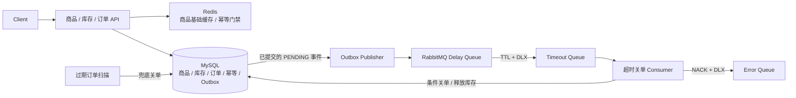
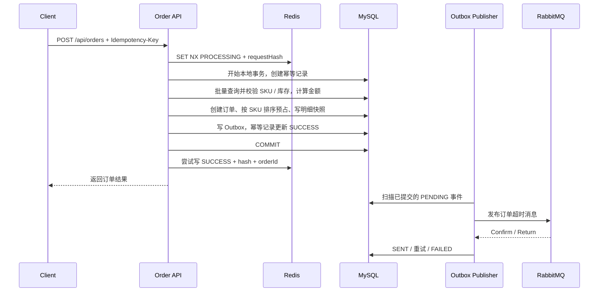

# OrderFlow

**商品、库存与订单核心后端工程。**基于 Spring Boot，围绕下单主链路实践库存并发控制、请求幂等、Redis 缓存、Transactional Outbox、RabbitMQ 超时关单及实验验证。

**技术栈：**Java 21 · Spring Boot 4.1.1 · MyBatis-Plus 3.5.17 · MySQL 8.x · Redis · RabbitMQ · Maven · k6

## Project Overview

项目围绕“请求重复、库存竞争、数据库与消息双写、热点缓存失效、订单到期”五类问题实现核心链路：

- **库存与状态竞争：**数据库条件 UPDATE 预占库存，支付、取消通过订单状态条件更新竞争执行权。
- **请求幂等：**Redis 做快速竞争过滤，数据库唯一幂等记录保存成功结果；requestHash 区分同 Key 的不同请求内容。
- **事务 Outbox：**订单、库存、明细与消息事件同事务提交，后台结合 Confirm / Return、有限重试及失败重放投递。
- **超时关单：**TTL + DLX 触发检查，Consumer 再核对数据库状态和到期时间，扫描任务补偿漏关订单。
- **商品缓存：**基础信息 Cache Aside，空值缓存与互斥重建减少回源；库存每次查询 MySQL。

**已有实验记录：**100 VU / 500 请求竞争 100 库存，100 单成功、400 单库存不足；200 次幂等重放均返回原订单。50 VU / 60s 下，单热点 SKU 为 **377.87 req/s**，分散 SKU 对照为 **1316.43 req/s**。详见[实验结果](#verification--performance)。

## Architecture



MySQL 是订单、库存与持久幂等结果的依据；Redis 与 RabbitMQ 均在下单数据库事务之外参与流程。

## Core Engineering Design

### 1. Concurrent Inventory Control

Java 层批量查询 SKU / 库存并做预检查，真正的并发防线是数据库原子条件更新：

```sql
UPDATE inventory
SET available_stock = available_stock - ?,
    reserved_stock = reserved_stock + ?
WHERE sku_id = ?
  AND available_stock >= ?;
```

InnoDB 配合 `UNIQUE(sku_id)` 定位库存记录，检查与扣减在同一条 SQL 中完成；影响行数为 0 时拒绝下单并回滚，正数数量的预占不能将可用库存扣成负数。该机制依赖数据库更新锁，而非 Java `synchronized`。创建、支付与各取消路径按 `skuId` 排序操作库存，降低反向加锁风险。

支付仅更新 `PENDING_PAYMENT` 且未到期的订单；超时取消仅更新 `PENDING_PAYMENT` 且已到期的订单。状态转换与库存确认 / 释放同事务完成，重复关单不会再次释放库存。

### 2. Request Idempotency

以 `(userId, Idempotency-Key)` 标识请求，按 SKU 排序后计算 SHA-256 `requestHash`。Redis 保存 `PROCESSING:<hash>` 或 `SUCCESS:<hash>:<orderId>`，两条路径均比较 hash：同 Key 异内容返回冲突，同内容成功重放返回原订单。

数据库 `order_request` 通过 `UNIQUE(user_id, idempotency_key)` 保持持久去重，`PROCESSING → SUCCESS + orderId` 与订单事务一起提交。Redis 仍为 PROCESSING 时会核对数据库已提交结果；数据库已成功、Redis 成功回写失败时仍返回业务结果。幂等重放返回同一订单资源，订单状态可能已变为 PAID / CANCELLED。

### 3. Transactional Outbox

数据库事务与 RabbitMQ 发布不属于同一个事务边界：提交前发送可能产生回滚后的消息，提交后直接发送又存在进程中断导致漏发的窗口。

项目将 `orders / inventory / order_item / order_request / mq_outbox` 的写入放在同一本地事务中，提交后由 Publisher 扫描 `PENDING` 事件。发送检查 correlated Confirm 与 mandatory Return；成功标记 `SENT`，失败安排重试，最多尝试 5 次后标记 `FAILED`，支持人工重新投递。发送成功但状态尚未落库时仍可能重复发布，因此消费端需要业务幂等。

### 4. RabbitMQ Timeout Cancellation

```text
已提交 Outbox → Delay Exchange → Delay Queue
    → TTL 到期 / DLX → Timeout Exchange → Timeout Queue
    → Consumer → 检查状态与 expire_at → 取消订单并释放预占库存
```

使用普通 DirectExchange 与队列 TTL / DLX。Consumer 调用 `cancelOrderIfExpired`，业务事务完成后 manual ACK；异常执行 `NACK(requeue=false)`，通过 Timeout Queue 配置的 DLX 路由到 Error Queue。已支付或已取消订单不再变更；每 30 秒最多扫描 100 个过期订单做数据库兜底。

当前配置默认 **20 秒**，`perf` profile 为 **1800 秒**；同一个 `order.timeout-seconds` 配置用于订单 `expire_at` 和队列 TTL。TTL 从入队开始计时，Outbox 积压与重试会延后触发，关单不是精确定时承诺。

### 5. Redis Product Cache

缓存商品和 SKU 基础信息，**库存每次批量读取 MySQL**。不存在商品写入 2 分钟空值；正常缓存使用 25～35 分钟随机 TTL。冷热点通过 `SET NX` 重建锁、Double Check、有限轮询等待合并基础数据重建；Lua 比较 token 后删除锁，防止误删其他持有者的锁。

商品更新与新增 SKU 在数据库成功提交后删除所属商品缓存。提交后失效仍存在旧读晚回填、删除失败等一致性窗口，目前没有可靠失效重试。

## Order Creation Flow

以下展示新请求成功创建订单的路径；重复请求在幂等分支返回历史订单、处理中或内容冲突。



返回订单不等待 MQ 投递。单次请求最多包含 50 种 SKU，金额使用数据库价格与 BigDecimal，明细保存成交时的单价、编码和规格快照。

## Verification & Performance

以下引用[已保存的实验记录](perf/results/performance-summary.md)。机制说明对应当前实现；实验未作为每次代码修改的自动回归，环境规格与原始时序输出尚未完整归档。

| Scenario | 验证方式 | 已记录结果 |
|---|---|---|
| Hot SKU：50 VU / 60s | k6 创建接口压测 | **377.87 req/s**；Avg 132.06 ms；P95 176.36 ms；P99 198.25 ms |
| Distributed SKU：50 VU / 60s | k6 负载分布对照 | **1316.43 req/s**；Avg 37.89 ms；P95 46.93 ms；P99 67.37 ms |
| Oversell：100 VU / 500 请求 | k6 + 数据库核对 | 100 库存，100 单成功、400 单库存不足、0 非预期错误；最终 available=0、reserved=100 |
| Idempotency SUCCESS Replay | k6 + 数据库核对 | 1 次原始请求 + 200 次重放，200 次均返回原订单；只创建 1 单，额外预占库存为 0 |
| Idempotency Race | k6 + 数据库核对 | 50 请求首次竞争同 Key；当次 1 个成功响应、49 个 PROCESSING；最终 1 条幂等记录、1 单、预占 1 次 |
| Cache Hit | k6 请求 + 应用日志 | 首次重建商品基础数据，后续命中 Redis 基础缓存 |
| Cache Breakdown | k6 + 重建日志核对 | 100 并发请求均成功，商品基础数据重建 1 次；Avg 499.38 ms，P95 501.62 ms |
| MQ Timeout Cancellation | 手工 MQ 正确性验证 | 未支付订单到期后 CANCELLED，库存释放，消息 ACK |
| MQ Consumer Failure | 手工异常注入验证 | 消费异常后 NACK、不 requeue，消息进入 Error Queue |

关键结论：

- 单热点 SKU 从 30 → 50 VU，吞吐由 385.82 变为 377.87 req/s，时延上升，观察到当前本地负载下约 **380 req/s** 的吞吐平台。
- 分散场景把请求分配到 10 个 SKU，**每张订单仍只购买一个 SKU**。50 VU 下吞吐相差约 **3.48 倍**，支持热点库存记录竞争是重要瓶颈之一；这是负载对照，不是代码优化前后提升。
- 防超卖与幂等结论结合响应统计、订单数和最终库存核对。HTTP 200 不等于业务成功，需检查响应体 `code` 和订单数据；1 / 49 的响应分布会受并发时序影响。
- 缓存重建 1 次只指商品基础数据；详情库存仍读 MySQL。MQ 手工验证证明所测流程的正确性，不代表消息吞吐或所有故障场景已验证。

## API Overview

默认地址：`http://localhost:8080`。响应格式为 `{ code, message, data }`。

| Method | Path | 用途 |
|---|---|---|
| POST | `/api/orders` | 创建订单，必需 `Idempotency-key` Header |
| POST | `/api/orders/{orderId}/pay` | 模拟支付状态转换与库存确认 |
| POST | `/api/orders/{orderId}/cancel` | 主动取消待支付订单并释放库存 |
| GET | `/api/orders/{orderId}` | 查询订单与明细 |
| GET | `/api/orders?userId=1&page=1&pageSize=10` | 分页查询用户订单 |
| GET | `/api/products/{id}` | 商品 / SKU 基础信息与数据库库存 |
| POST | `/api/products` | 创建商品 |
| POST | `/api/products/{productId}/skus` | 创建 SKU 和初始库存 |
| POST | `/api/inventory/{skuId}/replenish` | 补充可用库存 |
| GET | `/api/admin/oubox/failed` | 查询失败 Outbox 记录 |
| POST | `/api/admin/oubox/{id}/replay` | 重置 FAILED 事件以重新投递 |

管理接口的 `oubox` 拼写与当前代码一致。创建请求示例（`skuId` 替换为实际创建的 SKU，同一次请求重试沿用原 Key）：

```http
POST /api/orders
Content-Type: application/json
Idempotency-key: order-demo-001

{"userId":1,"items":[{"skuId":1,"quantity":1}]}
```

## Project Structure

```text
src/main/java/com/orderflow/orderflowbackend/
├── product/       # 商品、SKU、基础数据缓存
├── inventory/     # 库存预占、确认、释放和补充
├── order/         # 创建、查询、幂等、超时消息、Outbox与补偿扫描
└── common/ · config/ · exception/
src/main/resources/ # 默认配置与 perf profile
src/test/           # Spring Boot集成测试、库存并发与缓存并发测试
sql/                # MySQL建表SQL
perf/scripts/       # k6场景脚本
perf/results/       # 实验结果记录
```

## Getting Started

### 1. 环境与数据库

准备 JDK **21**、MySQL **8.x**、Redis、RabbitMQ；Maven Wrapper 指定 **3.9.16**，也可使用本机 Maven。Redis / RabbitMQ 服务版本未在仓库中锁定，依赖服务需自行部署。

在仓库根目录启动 MySQL CLI，使用自己的账户连接后执行：

```sql
CREATE DATABASE IF NOT EXISTS orderflow
  CHARACTER SET utf8mb4 COLLATE utf8mb4_unicode_ci;
USE orderflow;
SOURCE sql/02_tables.sql;
```

[建表文件](sql/02_tables.sql)定义 7 张 InnoDB 表及库存、幂等、Outbox 等唯一索引；它只创建不存在的表，不会迁移已有表，也不提供种子数据。应用和 MySQL 的时区应保持一致；下方连接示例使用 `Asia/Shanghai`。

### 2. 配置与启动

用自己的服务参数覆盖[默认配置](src/main/resources/application.yaml)。下面是 PowerShell 示例，尖括号内容替换为个人环境值，凭据不写入 README 或提交到 Git：

```powershell
$env:SPRING_DATASOURCE_URL = "jdbc:mysql://localhost:3306/orderflow?serverTimezone=Asia/Shanghai"
$env:SPRING_DATASOURCE_USERNAME = "<数据库用户>"
$env:SPRING_DATASOURCE_PASSWORD = "<数据库密码>"
$env:SPRING_DATA_REDIS_HOST = "localhost"
$env:SPRING_DATA_REDIS_PORT = "6379"
$env:SPRING_RABBITMQ_HOST = "localhost"
$env:SPRING_RABBITMQ_PORT = "5672"
$env:SPRING_RABBITMQ_USERNAME = "<RabbitMQ用户>"
$env:SPRING_RABBITMQ_PASSWORD = "<RabbitMQ密码>"
$env:SPRING_RABBITMQ_VIRTUAL_HOST = "/"
.\mvnw.cmd spring-boot:run
```

已安装 Maven 可使用 `mvn spring-boot:run`，Linux / macOS 使用 `./mvnw spring-boot:run`，连接参数通过相应环境变量设置。HTTP 默认端口为 8080；RabbitMQ账号需具备该 vhost 的资源声明、发布和消费权限。

先通过商品创建及 SKU 创建接口准备数据，SKU 的 `status` 设为 1，并设置 `initialStock`。现有集成测试使用固定 ID、会删除订单全表或清理缓存；仓库尚无独立 `application-test` 配置，执行 `mvn test` 前必须隔离测试数据库和依赖服务。

<details>
<summary>最小测试数据请求体</summary>

先向 `POST /api/products` 提交 `{"name":"Demo Product","description":"本地验证"}`，取得返回的商品 ID；再向 `POST /api/products/{productId}/skus` 提交：

```json
{"skuCode":"DEMO-001","spec":"标准款","price":99.00,"initialStock":100000,"status":1}
```

使用返回的 SKU ID 下单；分散负载需准备多个 SKU，各自使用不同的 `skuCode`。

</details>

## Performance Test

安装 k6，停止已有应用实例后，以 `perf` profile 启动以避免短时创建压测受到 20 秒关单干扰：

```powershell
$env:SPRING_PROFILES_ACTIVE = "perf"
$env:SPRING_RABBITMQ_VIRTUAL_HOST = "<已创建并授权的压测vhost>"
.\mvnw.cmd spring-boot:run
```

`perf` 将订单超时设为 1800 秒，Publisher 和扫描任务仍运行。切换默认 / perf 时使用独立 RabbitMQ vhost，避免同名队列以不同 TTL 参数重复声明。

以下从仓库根目录执行；单 SKU 示例 ID 按实际数据替换。分散脚本当前固定使用 SKU **9～18**，需准备对应数据或调整脚本中的 `SKU_IDS`：

```bash
k6 run --summary-trend-stats "avg,p(95),p(99)" -e VUS=50 -e DURATION=60s -e SKU_ID=9 perf/scripts/order-create.js
k6 run --summary-trend-stats "avg,p(95),p(99)" -e VUS=50 -e DURATION=60s perf/scripts/order-create-multi-sku.js
k6 run -e SKU_ID=19 perf/scripts/order-oversell.js
k6 run -e SKU_ID=3 perf/scripts/order-idempotency.js
k6 run -e SKU_ID=2 perf/scripts/order-idempotency-race.js
k6 run -e PRODUCT_ID=3 perf/scripts/product-cache-breakdown.js
```

性能测试需准备充足库存；防超卖测试须将目标 SKU 重置为 available=100、reserved=0（脚本固定 100 VU / 500 请求）。击穿测试前仅在隔离环境删除目标 `product:detail:{id}` 缓存，再结合 `CACHE_DB_REBUILD` 日志计数核对基础数据重建次数。脚本不自动初始化数据库，也不自动核对所有最终数据库状态。

材料入口：[k6 脚本](perf/scripts/) · [性能与正确性记录](perf/results/performance-summary.md) · [单热点基线](perf/results/single-sku-baseline.md) · [perf 目录说明（待补充）](perf/README.md)。

## Engineering Boundaries

- 项目聚焦核心后端流程；支付为状态模拟，尚无真实支付网关、身份鉴权和订单归属校验。
- 性能数字来自已记录的本地创建接口实验，不代表跨环境上限或持续端到端容量；当前 Publisher 每轮最多串行发送 100 条、完成后再等待 2 秒，持续高下单率下可能积压。
- Outbox 采用有限重试与人工失败重放，允许重复消息；多实例发布抢占和 Error Queue 恢复流程尚未完善，未承诺绝对无丢失投递。
- 超时消息与数据库扫描都可能延后关单；扫描每轮处理量有限，尚未验证大规模消息故障时的恢复能力。
- Redis 前置故障降级、幂等旧格式兼容和缓存失效补偿尚不完整；提交后删除缓存改善提交顺序，但不提供强一致缓存保证。
